# PlexCleaner Architecture

This document describes the architecture, processing pipeline, and design patterns of PlexCleaner for contributors and agents working on the codebase. Cross-cutting agent and workflow governance lives in [AGENTS.md](./AGENTS.md) and [GOVERNANCE.md](./GOVERNANCE.md), the CI/CD workflow contract in [WORKFLOW.md](./WORKFLOW.md), C# code style in [CODESTYLE.md](./CODESTYLE.md), and GitHub Copilot review mechanics in [.github/copilot-instructions.md](./.github/copilot-instructions.md).

## Project Overview

PlexCleaner is a .NET 10.0 CLI utility that optimizes media files for Direct Play in Plex/Emby/Jellyfin by:

- Converting containers to MKV format
- Re-encoding incompatible video/audio codecs
- Managing tracks (language tags, duplicates, subtitles)
- Verifying and repairing media integrity
- Removing closed captions and unwanted content
- Monitoring folders for changes and automatically processing new/modified files

The tool orchestrates external media processing tools (FFmpeg, HandBrake, MkvToolNix, MediaInfo, 7-Zip) via CLI wrappers.

## Documentation

User-facing documentation is organized as follows:

- **[README.md](./README.md)**: Main project documentation, quick start, installation, usage, and FAQ.
- **[Docs/LanguageMatching.md](./Docs/LanguageMatching.md)**: Technical details on IETF/RFC 5646 language tag matching and configuration.
- **[Docs/CustomOptions.md](./Docs/CustomOptions.md)**: FFmpeg and HandBrake custom encoding parameters, hardware acceleration setup, and encoder options.
- **[Docs/ClosedCaptions.md](./Docs/ClosedCaptions.md)**: Detailed technical analysis of EIA-608/CTA-708 closed caption detection methods and tools.
- **[HISTORY.md](./HISTORY.md)**: Release notes and version history.

## Architecture

### Command Structure

PlexCleaner provides multiple commands:

- **process**: Batch process media files in specified folders, see [Process Command Logic](#process-command-logic)
- **monitor**: Watch folders for changes and automatically process modified files
- **verify**: Verify media files using FFmpeg
- **remux**: Re-multiplex media files to MKV
- **reencode**: Re-encode media tracks using HandBrake or FFmpeg
- **deinterlace**: De-interlace media files
- **createsidecar**: Create sidecar files for existing media
- **gettoolinfo**: Display tool version information
- **gettagmap**: Analyze language tags across media files
- **getmediainfo**: Extract and display media properties
- **checkfornewtools**: Check for and download tool updates (Windows only)
- **defaultsettings**: Create default configuration file
- **createschema**: Generate JSON schema for configuration validation
- **removesubtitles**: Remove all subtitle tracks
- **removeclosedcaptions**: Remove embedded EIA-608/CTA-708 closed captions from video streams
- **updatesidecar**: Create or update sidecar files to current schema/tool info
- **getsidecarinfo**: Display sidecar file information
- **testmediainfo**: Test parsing media tool information for non-Matroska containers
- **getversioninfo**: Print application and media tool version information

### Fluent Builder Pattern for Media Tools

All media tool command-line construction uses fluent builders (`*Builder.cs`). Never concatenate strings:

```csharp
// Correct - fluent builder pattern
FfMpeg.GlobalOptions command = new FfMpeg.GlobalOptions(args)
    .Default()
    .Add(customOption);

// Wrong - string concatenation
string rawArguments = "-hide_banner " + option;
```

### Process Execution with CliWrap

All external process execution uses [CliWrap](https://github.com/Tyrrrz/CliWrap) (v3.x):

- Builders create `ArgumentsBuilder` instances
- Execute via `Cli.Wrap(toolPath).WithArguments(builder)`
- Use `BufferedCommandResult` for output capture
- See `MediaTool.cs` for base execution patterns
- All tool execution supports cancellation via `Program.CancelToken()`

### Runtime Metrics

`Metrics.cs` owns a single `System.Diagnostics.Metrics.Meter` (`PlexCleaner.Process`) published for the whole process and read externally with `dotnet-counters` (no config flag, and instruments are inert until observed).

- Hooks: `ProcessDriver.ProcessFiles` (the choke point every command and monitor cycle funnels through) drives the file/byte/in-flight instruments and the operation-weighted `progress.ratio`. `Process.ProcessFiles` records the per-`SidecarFile.StatesType` outcomes. `MediaTool` execution paths record `tool.duration`.
- Progress is operation-weighted, not file count: each heavy full-file operation counts the file's size as work to do when it starts and as work done when it finishes, so the total grows as operations are discovered rather than being summed up front.
- Run-scoped gauges (totals, in-flight, progress, ETA) reset per `ProcessFiles` call, while the counters stay cumulative for the process. All writers use `Interlocked`, so the parallel loop needs no lock, and observable-gauge callbacks only read. Tags are bounded (`state`, `tool`) - no filename tags.

### Sidecar File System

Critical performance feature - DO NOT break compatibility:

- With `UseSidecarFiles` on, each `.mkv` gets a `.PlexCleaner` sidecar JSON file
- Contains: processing state, tool versions, media properties, file hash
- Hash: First 64KB + last 64KB of file (not timestamp-based)
- Schema versioned (`SchemaVersion: 5` in `SidecarFileJsonSchema5`, global alias in `GlobalUsings.cs`)
- A `Verified`, `VerifyFailed` or scanned state skips only the checks that read it, see [Sidecar Refresh](#sidecar-refresh)
- State flags are bitwise: `StatesType` enum with `[Flags]` attribute
- Sidecar operations: `Open()`, `Create()`, `Read()`, `Update()`, see [Sidecar Refresh](#sidecar-refresh)

### Media Tool Abstraction

- `MediaTool` base class defines tool lifecycle
- Each tool family has: Tool class, Builder class, Info schema
- Tool version info retrieved from CLI output, cached in `Tools.json`
- Windows supports auto-download via `GitHubRelease.cs`; Linux uses system tools
- Tool paths: `ToolsOptions.UseSystem` or `RootPath + ToolFamily/SubFolder/ToolName`
- Tool execution: Base `Execute()` method with cancellation, logging, and error handling
- Version checking: `GetInstalledVersion()`, `GetLatestVersion()` (Windows only)
- Minimum version: `MediaTool.MinimumVersion` sets one minimum per tool family, and `Tools.VerifyTools()` fails startup before processing when an installed tool is older
- Version-dependent tool behavior raises its family's minimum rather than branching per version at a call site

### Media Properties and Track Management

**MediaProps hierarchy:**

- `MediaProps`: Container for all media information (video, audio, subtitle tracks)
- `TrackProps`: Base class for all track types
  - `VideoProps`: Video track properties (format, resolution, codec, HDR, interlacing)
  - `AudioProps`: Audio track properties (format, channels, sample rate, codec)
  - `SubtitleProps`: Subtitle track properties (format, codec, closed captions)

**Track properties:**

- Language tags: ISO 639-2B (`Language`) and RFC 5646/BCP 47 (`LanguageIetf`)
- Flags: Default, Forced, HearingImpaired, VisualImpaired, Descriptions, Original, Commentary
- State: Keep, Remove, ReMux, ReEncode, DeInterlace, SetFlags, SetLanguage, Unsupported
- Title, Format, Codec, Id, Number, Uid

**Track selection (`SelectMediaProps.cs`):**

- Separates tracks into Selected/NotSelected categories
- Used for language filtering, duplicate removal, codec selection
- Move operations: `Move(track, toSelected)`, `Move(trackList, toSelected)`
- State assignment: `SetState(selectedState, notSelectedState)`

### Language Tag Management

**IETF/RFC 5646 Support:**

- Uses external package `ptr727.LanguageTags` for language tag parsing and matching
- Tag format: `language-extlang-script-region-variant-extension-privateuse`
- Matching: Left-to-right prefix matching via `LanguageLookup.IsMatch()`
- Conversion: ISO 639-2B <-> RFC 5646 via `GetIsoFromIetf()`, `GetIetfFromIso()`
- Special tags: `und` (undefined), `zxx` (no linguistic content), `en` (English)

**Language processing:**

- Only MkvMerge reports IETF tags, and a missing one is derived from the ISO 639-2B tag
- MkvMerge normalizes to IETF tags when `SetIetfLanguageTags` enabled
- FFprobe uses tag metadata which may differ from track metadata
- Track validation: Checks ISO/IETF consistency, sets error states for mismatches

### Monitor Mode

**File system watching:**

- Uses `FileSystemWatcher` to monitor specified folders
- Monitors: Size, CreationTime, LastWrite, FileName, DirectoryName
- Handles: Changed, Created, Deleted, Renamed events
- Queue-based: Changes added to watch queue with timestamps

**Processing logic:**

- Files must "settle" (no changes for `MonitorWaitTime` seconds) before processing
- Files must be readable (not being written) before processing
- Cleanup: deletes empty folders when `DeleteEmptyFolders` is on, see [Run Flow](#run-flow)
- Pre-process: Optional initial scan of all monitored folders on startup

**Concurrency:**

- Lock-based queue management (`_watchLock`)
- Periodic processing (1-second poll interval)
- Supports parallel processing when `--parallel` enabled

### XML and JSON Parsing

AOT-safe parsers in `MediaInfoXmlParser.cs`:

- **MediaInfoFromXml()**: Parses specific MediaInfo XML elements into `MediaInfoToolXmlSchema.MediaInfo`
  - Manually parses only known elements needed by PlexCleaner (id, format, language, etc.)
  - Used by sidecar file system to parse XML output when JSON unavailable
  - Avoids XmlSerializer (not AOT-compatible)
- **GenericXmlToJson()**: Converts any XML file to JSON format
  - Preserves all elements and attributes (unlike MediaInfoFromXml's selective parsing)
  - Handles attributes: prefix with `@` for elements with children, no prefix for leaf elements
  - Detects arrays: elements appearing multiple times become JSON arrays
  - Two-pass algorithm: collect children to detect arrays, then write JSON
  - Uses `XmlReader` and `Utf8JsonWriter` for streaming efficiency
  - Special handling for MediaInfo's mixed attribute/text content format (creatingLibrary)
- **MediaInfoXmlToJson()**: Converts parsed MediaInfo XML to MediaInfo JSON schema
  - Bridges between XML and JSON schema types
  - Maps only known MediaInfo track properties

Parser design patterns:

- Forward-only `XmlReader` with depth tracking for streaming
- Recursive `ElementData` tree for generic XML-to-JSON conversion
- Namespace filtering (skip `xmlns`, `xsi` attributes)
- Special handling for MediaInfo's mixed attribute/text content format

### Extensions Pattern

**Modern C# 13 extension syntax:**

- Uses implicit class extensions: `extension(ILogger logger)`
- Provides context-aware helper methods
- Examples:
  - `LogAndPropagate()`: Log exception and return false (propagates error)
  - `LogAndHandle()`: Log exception and return true (handles error for catch clauses)
  - `LogOverrideContext()`: Create scoped logger with LogOverride context

## Process Command Logic

The diagrams below trace the `process` command from the command line to the result of each file. They describe what the code does today, including branches that look wrong, so a reader can compare code and docs branch by branch.

Conventions used in every diagram:

- A label that starts with `Name()` or `Type.Name()` names the method that runs that node. `ArchitectureDiagramTests` checks that each named method exists, so a rename breaks the test until the diagram follows. An unqualified name resolves against the core process classes the test lists. A name more than one of them defines must carry its `Type.` prefix. Pipeline `P` nodes name `ProcessFile` steps, which the step order check holds to `Process.cs` instead.
- Any other label is prose, and an option name in it refers to the settings file or a command-line flag.
- A rounded node is an exit.
- A tool step drawn without a fail edge still fails the file when its tool fails.
- A node styled with a dashed red border is a suspect branch. Its `S` number points into [Suspect Branches](#suspect-branches).
- Change a diagram in the same change that moves a branch it draws.

### Run Flow

`Program.ProcessCommand()` drives one run, and `Monitor.ProcessChanges()` joins the same flow for each batch of settled folders. `Create()` sets the thread count to 1 without `--parallel`. With `--parallel`, a `--threadcount` of 0 becomes half the cores, clamped to 1 through 4. Any other value is clamped to 1 through the core count.

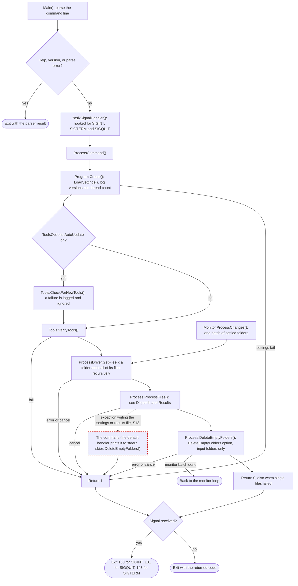

`Monitor.ProcessChanges()` runs the same `GetFiles()`, `ProcessFiles()` and `DeleteEmptyFolders()` sequence for each batch of folders that have been quiet for the settle time. A successful batch returns to the monitor loop. A failure ends the loop, and the monitor command then exits with 1, or with the signal's code after a cancel.

### Dispatch and Results

`ProcessDriver.GetFiles()` neither sorts nor removes duplicates, so the processing order is not defined. Grouping by the path without its extension keeps a media file and its sidecar on one thread.

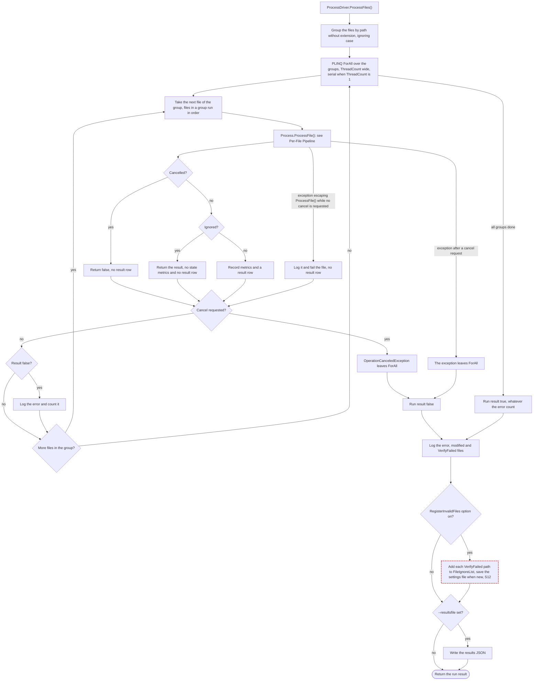

### Per-File Pipeline

`Process.ProcessFile()` runs one file through the steps below, in this order. The node ids `P01` onward follow the order of the step calls in `Process.ProcessFile()`, and `ArchitectureDiagramTests` fails when they differ.

A step that returns false leaves the chain at the abort node, except `DeleteNonMkvFile()`, whose false return ends the file as a success. From `RemuxByExtension()` on, a cancel seen after a step does the same. `DeleteNonMkvFile()`, `IsSidecarWriteable()`, `MakeExtensionLowercase()` and `VerifyMediaInfo()` have no cancel check after them. A step that throws while no cancel is requested also leaves the chain at the abort node.

```mermaid
flowchart TD
  G1{"In FileIgnoreList or matched by FileIgnoreMasks?"} -->|yes| IGN(["Ignored, result true"])
  G1 -->|no| G2{"File exists?"}
  G2 -->|no| NOF(["Result false, no state and no delete"])
  G2 -->|yes| G3["Create the ProcessFile state holder and save the write time"]
  G3 --> P01["IsWriteable()"]
  P01 -->|"read-only, skipped"| AB
  P01 --> P02["DeleteMismatchedSidecarFile()"]
  P02 -->|"orphan sidecar deleted, S3"| AB
  P02 --> G4{"SidecarFile.IsSidecarFile()"}
  G4 -->|yes| IGN
  G4 -->|no| P03["RemuxByExtension(): ReMux, ReMuxExtensions"]
  P03 --> P04["DeleteNonMkvFile(): DeleteUnwantedExtensions"]
  P04 -->|"not MKV, deleted or skipped"| SKP(["Result true, not ignored"])
  P04 --> P05["IsSidecarWriteable()"]
  P05 -->|"sidecar exists and is read-only, skipped"| AB
  P05 --> P06["MakeExtensionLowercase()"]
  P06 --> P07["GetMediaProps(): see Sidecar Refresh"]
  P07 --> MAIN
  subgraph MAIN["Media steps"]
    P08["RemuxNonMkvContainer(): ReMux"] --> P09["RemuxRemoveExtraVideoTracks(): ReMux"]
    P09 --> P10["VerifyTrackCounts()"]
    P10 --> P11["RemoveCoverArt(): ReMux"]
    P11 --> P12["RemoveTags(): RemoveTags"]
    P12 --> P13["VerifyMediaInfo()"]
    P13 --> P14["RepairMetadataErrors(): AutoRepair"]
    P14 --> P15["RepairMatroskaStructure(): Verify"]
    P15 --> P16["RemoveClosedCaptions(): RemoveClosedCaptions"]
    P16 --> P17["DeInterlace(): DeInterlace"]
    P17 --> P18["SetUnknownLanguageTracks(): SetUnknownLanguage"]
    P18 --> P19["RemoveUnwantedLanguageTracks(): RemoveUnwantedLanguageTracks"]
    P19 --> P20["RemoveDuplicateTracks(): RemoveDuplicateTracks"]
    P20 --> P21["RepairDefaultFlags(): SetTrackFlags"]
    P21 --> P22["ReEncode(): ReEncode"]
    P22 --> P23["VerifyAndRepair(): Verify, AutoRepair"]
  end
  P23 --> G6{"Any step modified the file?"}
  G6 -->|yes| CLEAN
  G6 -->|no| P33
  subgraph CLEAN["Cleanup re-run"]
    P24["RemoveCoverArt(): ReMux"] --> P25["RemoveTags(): RemoveTags"]
    P25 --> P26["RepairMetadataErrors(): AutoRepair"]
    P26 --> P27["RepairMatroskaStructure(): Verify"]
    P27 --> P28["RemoveClosedCaptions(): RemoveClosedCaptions"]
    P28 --> P29["SetUnknownLanguageTracks(): SetUnknownLanguage"]
    P29 --> P30["RemoveUnwantedLanguageTracks(): RemoveUnwantedLanguageTracks"]
    P30 --> P31["RemoveDuplicateTracks(): RemoveDuplicateTracks"]
    P31 --> P32["RepairDefaultFlags(): SetTrackFlags"]
  end
  P32 --> P33["SetLastWriteTimeUtc(): RestoreFileTimestamp"]
  P33 --> P34["VerifyMediaInfo()"]
  P34 --> OK(["Result true"])
  P03 -.->|"false or cancel"| AB
  P06 -.->|false| AB
  P07 -.->|"false or cancel"| AB
  MAIN -.->|"any step false or cancel"| AB
  CLEAN -.->|"any step false or cancel"| AB
  P33 -.->|"false or cancel"| AB
  P34 -.->|false| AB
  THR["Any step throws while no cancel is requested"] -.-> AB
  AB["Abort the file, failedOperation names the step"] --> G5{"Skipped as read-only, or a step threw?"}
  G5 -->|yes| RET(["Result false, return the state and final path"])
  G5 -->|no| DF["DeleteFailedFile(): DeleteInvalidFiles deletes the media file, and the sidecar of an MKV file, unless cancelled, a tool run for the file failed to launch, threw, or was killed by a signal outside Windows, or the state has PostDecodeTimestamps"]
  DF --> RET
  classDef suspect stroke:#c00,stroke-width:2px,stroke-dasharray:5 3
  class P02 suspect
```

`ProcessDriver.ProcessFiles()` counts the tool runs of each file that fail to launch, are cancelled, or throw, since such a run leaves the media unjudged. Outside Windows, it counts a tool run a signal terminates the same way, since that run ended before a result. It counts an FfMpeg verify run a signal terminates apart, since an external kill and a crash on corrupt media exit alike. `DeleteFailedFile()` does not delete a file that had any such tool run. It also keeps a file whose state carries `PostDecodeTimestamps`. A delete that throws is logged, and the file counts as not deleted.

After `VerifyAndRepair()`, when any step modified the file, the steps from `RemoveCoverArt()` through `RepairDefaultFlags()` run again, except `VerifyMediaInfo()` and `DeInterlace()`. A rewrite by FfMpeg or HandBrake can undo their work. On a file no step modified, running the steps again would change nothing.

`VerifyTrackCounts()` fails a file with no video track or more than one, and only warns when there is no audio track. `VerifyMediaInfo()` fails a file when FfProbe, MkvMerge and MediaInfo disagree on the track count of any type. A rename from a remux or the lowercase step reaches the result as the new path.

### Sidecar Refresh

Every step that changes the file calls `Refresh()`. `Refresh(newName)` adds `FileReNamed` when the path changed, then reloads the media info. `GetMediaProps()` calls `Refresh(false)` and then fails a file that any tool reports as unsupported. A step that only changes the state calls `SaveState()`, which calls `Refresh(false)` only with `UseSidecarFiles` on.

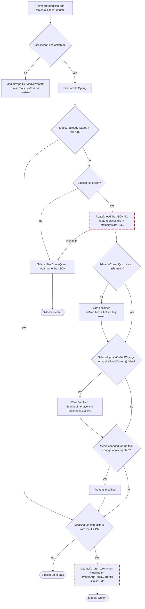

`IsMediaCurrent()` logs a changed write time and ignores it, because the write time is unreliable over SMB. The sidecar holds media info and state flags, and it never skips a whole file. A `Verified` or `VerifyFailed` flag skips only the checks that read it, such as verify and the scans for interlacing and closed captions. A clean scan of the whole file sets `ScannedInterlace` or `ScannedCaptions`, which skips only that scan. A later step that rewrites the file keeps both flags, because no step adds captions or interlacing to the media it writes.

### Remux and Container Steps

The remux steps rewrite the container and set `ReMuxed`. `RemoveTags()` and `RemoveAttachments()` edit the file in place with MkvPropEdit.

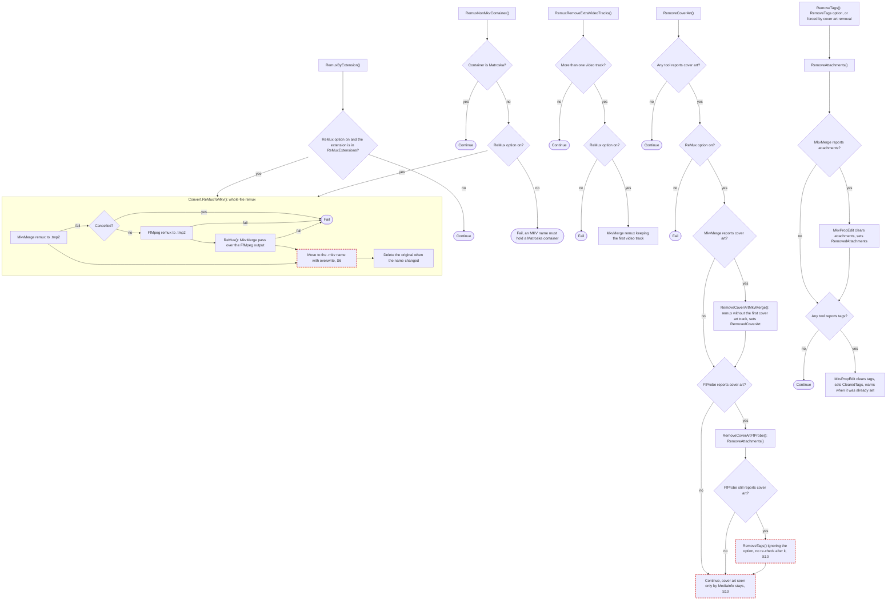

`MakeExtensionLowercase()` renames through a `.tmp7` name with overwrite, so it can also replace a sibling file, S6. `Convert.ReMuxToMkv()` with a track selection uses MkvMerge alone, with no FfMpeg fallback.

### Metadata and Structure Repair

`RepairMetadataErrors()` repairs the errors the media tools flagged while parsing. `SetVerifyFailed()` sets `VerifyFailed`, clears `Verified` and fails the file, which stops later runs from retrying the repair.

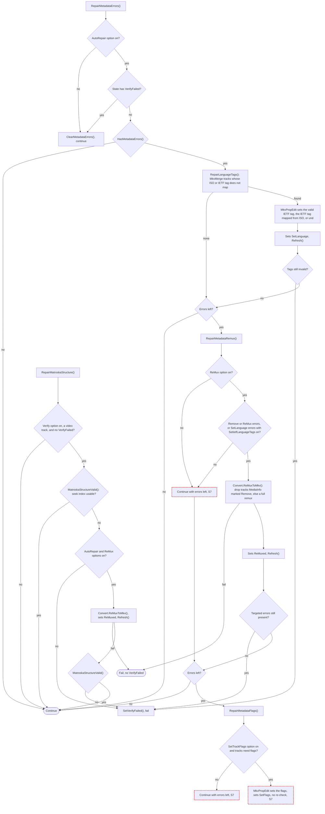

### Closed Captions

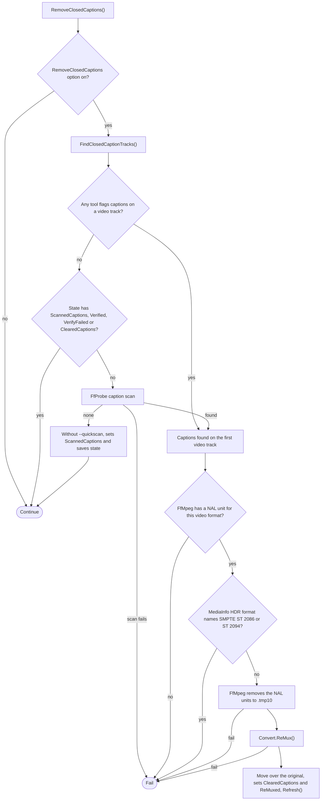

The HDR refusal is deliberate, so captions fail the file rather than pass unremoved. It matches HDR10 and HDR10+, and also Dolby Vision with an HDR10 base layer.

### Deinterlace

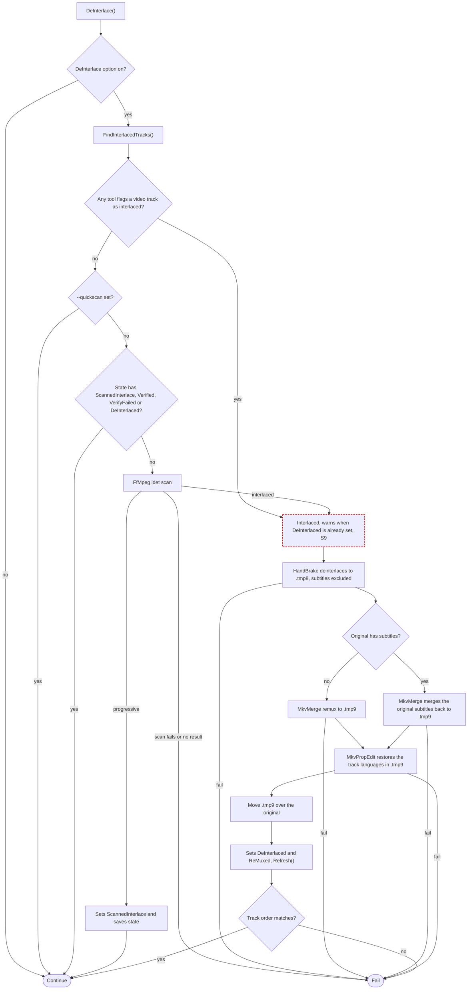

### Track Selection

All of these steps read the MkvMerge track list, since only MkvMerge reports IETF language tags. `FindPreferredAudio()` picks the first track whose format comes earliest in `PreferredAudioFormats`, else the first track.

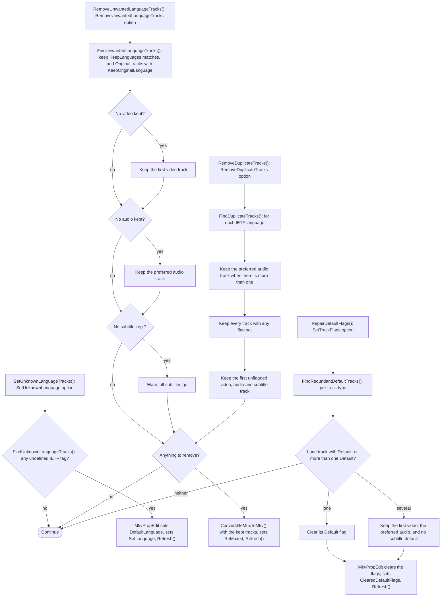

`KeepLanguages` always includes `zxx`, `und` and `DefaultLanguage`.

### Re-Encode

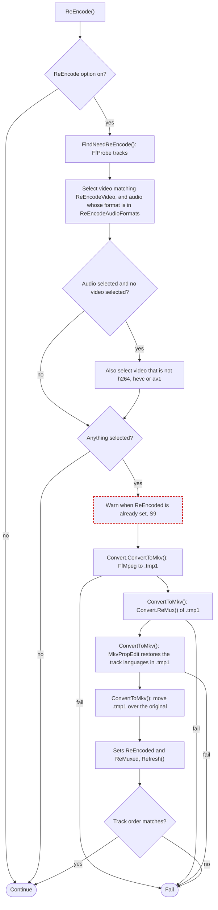

The `ConvertOptions` settings shape the FfMpeg and HandBrake command lines, and they decide no branch.

### Verify and Repair

`VerifyAndRepair()` verifies the media streams with FfMpeg and repairs what fails. `VerifyClassifier` reads the FfMpeg error output. A non-monotonic DTS line alone yields `TimestampOnly`, any other error line or a non-zero exit yields `DecodeError`, and no line yields `Clean`. A run a signal terminates also yields `DecodeError`, so the repair ladder still runs. Outside Windows, the file is never deleted on it. Outside Windows, a failed or skipped repair after such a run also leaves the state unchanged, so the next run verifies the file again. An FfMpeg run that fails to launch, is cancelled, or whose execution throws yields `ToolError`, which leaves the media unchecked. On the first verify the file then fails with its state unchanged. A repair also leaves the state unchanged when it fails while any of its tool runs did not run to a result. Such a run fails to launch, is cancelled, throws, or is terminated by a signal outside Windows. The next run then repairs again, so a repair tool that crashes on the same input repeats the repair on every run.

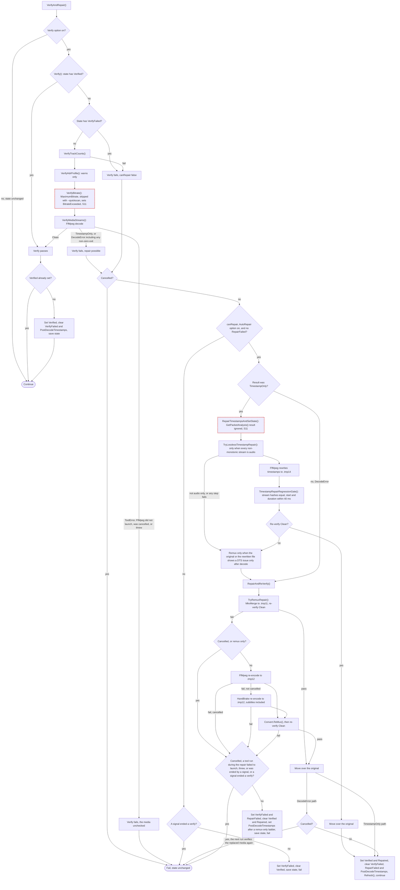

A repair failure that records state sets `RepairFailed` and `VerifyFailed` together, and `VerifyFailed` fails the verify before any repair. So the `RepairFailed` check before a repair matters only for a sidecar an earlier version wrote, which can hold `RepairFailed` without `VerifyFailed`. With the `Verify` option off, `VerifyAndRepair()` leaves the state unchanged, so `Verified` is set only by a verification that ran. With the `Verify` option on, a file with `VerifyFailed` fails again on each later run until its media changes and the sidecar resets to `FileModified`. `RegisterInvalidFiles` adds such a file to `FileIgnoreList` instead, so later runs ignore it.

### State Flags by Step

The table lists the `StatesType` flags each step sets, and the flags it clears. A rename adds `FileReNamed` and keeps the flags set so far, unless a sidecar already exists under the new name, S14.

| Step | Sets | Clears |
| --- | --- | --- |
| `DeleteMismatchedSidecarFile()`, `DeleteNonMkvFile()`, `DeleteFailedFile()` | `FileDeleted` | |
| `MakeExtensionLowercase()` | `FileReNamed` | |
| `RemuxByExtension()`, `RemuxNonMkvContainer()`, `RemuxRemoveExtraVideoTracks()` | `ReMuxed` | |
| `RemoveCoverArt()` | `ReMuxed`, `RemovedCoverArt`, `RemovedAttachments`, `ClearedTags` | |
| `RemoveTags()` | `RemovedAttachments`, `ClearedTags` | |
| `RepairMetadataErrors()` | `SetLanguage`, `ReMuxed`, `SetFlags`, `VerifyFailed` | `Verified` |
| `RepairMatroskaStructure()` | `ReMuxed`, `VerifyFailed` | `Verified` |
| `RemoveClosedCaptions()` | `ScannedCaptions`, `ClearedCaptions`, `ReMuxed` | |
| `DeInterlace()` | `ScannedInterlace`, `DeInterlaced`, `ReMuxed` | |
| `SetUnknownLanguageTracks()` | `SetLanguage` | |
| `RemoveUnwantedLanguageTracks()`, `RemoveDuplicateTracks()` | `ReMuxed` | |
| `RepairDefaultFlags()` | `ClearedDefaultFlags` | |
| `ReEncode()` | `ReEncoded`, `ReMuxed` | |
| `VerifyAndRepair()` | `Verified`, `VerifyFailed`, `Repaired`, `RepairFailed`, `PostDecodeTimestamps`, `BitrateExceeded` | `Verified`, `VerifyFailed`, `Repaired`, `RepairFailed`, `PostDecodeTimestamps` |
| `SidecarFile.Read()` | `FileModified` when the media changed | every other flag when the media changed, `Verified`, `ScannedInterlace` and `ScannedCaptions` on a tool change with `SidecarUpdateOnToolChange` on |

### Suspect Branches

Each entry describes a branch the diagrams mark, as the code behaves today, and links the issue that tracks its fix. Update the diagram and remove the entry when the fix lands.

- **S3** ([#1070](https://github.com/ptr727/PlexCleaner/issues/1070)): Deleting an orphan sidecar returns false, so the file counts as an error and runs `DeleteFailedFile()`. Deleting a non-MKV file in `DeleteNonMkvFile()` counts as a success.
- **S6** ([#1073](https://github.com/ptr727/PlexCleaner/issues/1073)): `Convert.ReMuxToMkv()` moves its output to the `.mkv` name with overwrite, so `name.avi` replaces an existing `name.mkv`. `MakeExtensionLowercase()` replaces a lowercase sibling on a case-sensitive filesystem the same way.
- **S7** ([#1074](https://github.com/ptr727/PlexCleaner/issues/1074)): `RepairMetadataErrors()` can pass with errors left. `RepairMetadataRemux()` does nothing with `ReMux` off, and `RepairMetadataFlags()` neither re-checks its result nor marks `VerifyFailed`.
- **S9** ([#1076](https://github.com/ptr727/PlexCleaner/issues/1076)): `ReEncode()` and `DeInterlace()` only warn when their flag is already set. `ReEncode()` processes output that still matches its selection again on every run. `DeInterlace()` does the same while a tool still flags the video as interlaced, since its idet scan skips a file already `DeInterlaced`.
- **S10** ([#1077](https://github.com/ptr727/PlexCleaner/issues/1077)): `RemoveCoverArt()` removes nothing when only MediaInfo reports cover art, and it does not re-check after the FfProbe path falls through to removing tags. Only a debug assertion catches the leftover.
- **S11** ([#1078](https://github.com/ptr727/PlexCleaner/issues/1078), [#1079](https://github.com/ptr727/PlexCleaner/issues/1079)): Failed bitrate and packet analysis results are ignored unless a signal ended the run, and `BitrateExceeded` is measured before any repair. No processing step clears it, so it lasts until the media changes outside PlexCleaner. `IsMediaAndToolsCurrent()` treats tools as current when `SidecarUpdateOnToolChange` is on, the opposite sense of `Read()`.
- **S12** ([#1080](https://github.com/ptr727/PlexCleaner/issues/1080)): `RegisterInvalidFiles` adds a `VerifyFailed` file to `FileIgnoreList` even when `DeleteFailedFile()` already deleted it.
- **S13** ([#1081](https://github.com/ptr727/PlexCleaner/issues/1081)): `Process.ProcessFiles()` writes the settings file and the results file without exception handling. The System.CommandLine default handler turns a write failure into exit code 1. The exception reaches stderr rather than the log, and `DeleteEmptyFolders()` does not run.
- **S14** ([#1082](https://github.com/ptr727/PlexCleaner/issues/1082)): When a rename lands on a name that already has a sidecar, `SidecarFile.Read()` replaces the in-memory state with the stored one. That drops `FileReNamed` and any flag the renaming step set.

## Code Conventions

For formatter, EditorConfig, pre-commit hooks, line endings, and charset details, see [CODESTYLE.md](./CODESTYLE.md).

### Code Style

- Target: .NET 10.0 (`<TargetFramework>net10.0</TargetFramework>`)
- AOT compilation is opt-in: `<PublishAot>false</PublishAot>` by default (matching the shipped builds, which load plugins via reflection); publish with `-p:PublishAot=true` to build an AOT binary, which excludes the plugin loader
- Use C# modern features (records, pattern matching, collection expressions, implicit class extensions)
- Prefer `Debug.Assert()` for internal invariants
- Logging: Serilog with thread IDs (`Log.Information/Warning/Error`)
- Exception handling: uses broad `catch(Exception)` blocks at boundary points
- Global usings: `GlobalUsings.cs` defines project-wide type aliases (`ConfigFileJsonSchema`, `SidecarFileJsonSchema`)
- `Directory.Build.props`: Common MSBuild properties (`TargetFramework`, `Nullable`, `ImplicitUsings`, `AnalysisLevel`, etc.) shared across all projects live here at the solution root. Do not duplicate these in individual `.csproj` files -- only add a property to a `.csproj` when it is project-specific or overrides the shared default.
- `Directory.Packages.props`: All NuGet package versions are centralised here via `PackageVersion` items. `PackageReference` elements in `.csproj` files must not include a `Version` attribute. Asset metadata (`PrivateAssets`, `IncludeAssets`) stays in the `.csproj` `PackageReference` element.

### Naming and Structure

- JSON schemas: Generated via `JsonSchema.Net`, suffixed with version (e.g., `SidecarFileJsonSchema5`)
- Builder methods: Return `this` for chaining
- Media props: `*Props.cs` classes (VideoProps, AudioProps, SubtitleProps, TrackProps)
- Options classes: `*Options.cs` for command categories (ProcessOptions, VerifyOptions, ConvertOptions, ToolsOptions)
- Partial classes: Tool families use partial class structure (`*Tool.cs`, `*Builder.cs`)

### Async and Concurrency

- Main loop: Uses `WaitForCancel()` polling pattern instead of async/await
- Tool execution: Synchronous wrappers around CliWrap async operations
- Parallel processing: PLINQ with `AsParallel()`, `WithDegreeOfParallelism()`
- Lock-based synchronization: `Lock` instances for collection access
- Cancellation: Global `CancellationTokenSource` accessed via `Program.CancelToken()`

## Logging Conventions

Serilog log levels describe the **nature** of an event, applied uniformly across the whole app - never "which command am I in". When adding or reviewing a log call, pick the level from what the event *is*, and keep the pipeline reading as a coherent story: *inspect -> decide to act -> do the work -> call the tool -> succeed or fail*.

- **Error** - an operation failed and could not complete (tool returned non-zero, IO/parse/verify failure, a step that aborts the file). Every early-exit failure path.
- **Warning** - the **trigger**: the orchestration layer inspected the file, interpreted the result, and has **decided to modify the media** (or detected a noteworthy non-fatal condition - unknown codec, cover art, language fallback, non-convergent repair, an interruption). Emitted **once**, at the decision point, *before* the modification. This is the event that elevates the per-file log from Warning to Information (see `PerFileLogLevel`), so `--loglevel Warning` shows every file that gets changed and why.
  - A "modification" is a write to the **media file**, including in-place metadata edits (MkvPropEdit flags/language/title) and container remuxes/renames. Sidecar cache writes and the results file are bookkeeping, not media modifications - they are Debug/Information, not Warnings.
  - **The media-manipulation code itself does not emit Warning.** Doing a remux or re-encode is that code's job, not a warning. Only the decision to run it is the Warning. Do not sprinkle Warnings through `Convert`, the media-tool wrappers, or the worker methods.
- **Information** - the high-level narrative of what the app is doing, readable end to end at the default level with no low-level mechanics: startup (banner, settings, tool versions), discovery (`Discovered N files`), batch lifecycle (`Starting {Command}, processing N files`, progress, `Completed`, the run summary), the per-file entry, read-only outcomes of note (skips), a worker **doing its job** (e.g. `Convert.ReMux` logging `Remux using MkvMerge`), and the intended output of read-only commands (`getmediainfo` / `getsidecarinfo` / `gettagmap` dumps).
- **Debug** - troubleshooting detail; *how* the work is done: raw tool invocations and command lines (`Executing MkvMerge : GetMediaPropsJson : args`, which carry the operation so a per-method "doing X" line is not needed), read/probe mechanics (`Reading media info from sidecar`, temp files, packet probes), per-track structural dumps during normal processing, inspection sub-steps (verify, bitrate, idet counting), and sidecar cache bookkeeping.
- **Verbose** - very granular: filesystem-watcher events, per-packet/byte-level progress.

The elevation trigger (Warning) must be preserved: keep exactly one decision-Warning per media modification, with the action at Information and the underlying tool at Debug.

### Tool execution and failure logging

- **Always consume a tool's output.** A subprocess whose stdout/stderr is not read can deadlock once it fills the pipe buffer, so never run a tool without consuming its pipes: `MediaTool.Execute` buffers them (summarize when the output is huge), and `ExecuteStreamStdErr` streams stderr line by line for the unbounded `-f null` verify pass. `Execute`, its cancellation path, and `LogFailedResult` record the **operation** (the calling method, captured via `[CallerMemberName]`, rendered with `:l`) so a command line ties to its purpose in a parallel log without correlating separate lines.
- **Tools write errors to different streams.** ffmpeg, ffprobe, HandBrake, and 7-Zip use **stderr**; the MkvToolNix tools (mkvmerge, mkvpropedit) write everything including errors to **stdout** (confirmed from the MkvToolNix source - all output goes through the one stdout object) and override `GetErrorOutput` to it. MediaInfo also emits to stdout but keeps the stderr default; its errors are caught by the `LogFailedResult` fallback, which reads the other captured stream when the tool's declared stream is empty, so an error is never lost.
- **Do not add a per-method debug line that just restates the command about to run** (e.g. `Getting media info`); the `Executing {Tool} : {operation} : args` line from `Execute` already covers it.

### Failure-handling philosophy

An **expected, recoverable** failure escalates through the standard repair tiers (detect -> surgical -> remux -> re-encode -> fail). A non-monotonic DTS that is only visible after decode stops after the remux, since a re-encode passes it only by dropping frames. A timestamp failure that remains once the surgical tier clears every demux-visible DTS also stops after the remux. An **unexpected or logic** failure (e.g. tool output that will not parse) aborts the file and stays a hard error. The bug then surfaces and gets fixed, rather than being masked by a fallback that silently mis-processes at scale.

## Common Patterns

### Command-Line Parsing

Uses `System.CommandLine` (v2.x):

- Options defined in `CommandLineOptions.cs`
- Binding via `CommandLineParser.Bind()`
- No `System.CommandLine.NamingConventionBinder` (deprecated)
- Recursive options: Available to all subcommands (`--logfile`, `--logwarning`, `--debug`)
- Command routing: Each command maps to static method in `Program.cs`

### Parallel Processing

- `--parallel` flag enables concurrent file processing
- Uses `ProcessDriver.cs` with `AsParallel()` and `WithDegreeOfParallelism()`
- Thread count: 1 without `--parallel`, else `--threadcount` clamped to 1 through the core count, where 0 means half the cores clamped to 1 through 4
- Lock-based collection updates in parallel contexts
- File grouping: Groups by path (excluding extension) to prevent concurrent access to same file

### File Processing States

```csharp
[Flags]
enum StatesType {
    None, SetLanguage, ReMuxed, ReEncoded, DeInterlaced,
    Repaired, RepairFailed, Verified, VerifyFailed,
    BitrateExceeded, ClearedTags, FileReNamed, FileDeleted,
    FileModified, ClearedCaptions, RemovedAttachments,
    SetFlags, RemovedCoverArt, ClearedDefaultFlags,
    PostDecodeTimestamps, ScannedInterlace, ScannedCaptions
}
```

Check states with `HasFlag()`, combine with `|=`. [State Flags by Step](#state-flags-by-step) lists which step sets each flag.

### Configuration Schema

- Settings: `PlexCleaner.defaults.json` with inline JSONC comments
- Schema: `PlexCleaner.schema.json` (auto-generated via JsonSchema.Net)
- Validation: JSON Schema.Net with source-generated context
- URL schema reference: `https://raw.githubusercontent.com/ptr727/PlexCleaner/main/PlexCleaner.schema.json`
- Versioned: ConfigFile schemas numbered (ConfigFileJsonSchema4, etc.)
- Defaults: `SetDefaults()` method in each options class
- Verification: `VerifyValues()` method validates configuration

### Keep-Awake Pattern

- Prevents system sleep during long operations
- Uses `KeepAwake.cs` with Windows API calls
- Timer-based: Refreshes every 30 seconds
- Cross-platform: No-op on non-Windows systems

### Cancellation Handling

- Global token source: `Program.s_cancelSource`
- Signal handlers: SIGINT, SIGTERM and SIGQUIT cancel the run and set exit codes 130, 143 and 131
- Tool execution: All CliWrap calls use `Program.CancelToken()`
- Graceful cleanup: Logs cancellation messages, disables file watchers

## Testing

### Test Framework

- xUnit v3.x with `AwesomeAssertions`
- Test project: `PlexCleanerTests/`
- Fixture: `PlexCleanerFixture` (assembly-level, sets up defaults and logging)
- Sample media: `Samples/PlexCleaner/` (relative path `../../../../Samples/PlexCleaner`)

### Test Coverage

- Command-line parsing: `CommandLineTests.cs`
- Configuration validation: `ConfigFileTests.cs`
- FFmpeg parsing: `FfMpegIdetParsingTests.cs`
- Sidecar functionality: `SidecarFileTests.cs`
- Version parsing: `VersionParsingTests.cs`
- Wildcards: `WildcardTests.cs`
- Filename escaping for filters: `FileNameEscapingTests.cs`

### Test Execution

- Task: `.NET Build` (VS Code task) for builds
- Unit tests: `dotnet test` or VS Code test explorer
- Docker tests: Download Matroska test files from GitHub
- CI: Separate workflows for build tests and Docker tests

### Regression Testing

- Cross-version processing-consistency checks against a curated media collection, with a ZFS-clone harness and Python catalog / reduce / locate / audit tooling under `RegressionTests/`. See [`RegressionTests/README.md`](./RegressionTests/README.md).

## Build and Release

The authoritative release governance is [GOVERNANCE.md](./GOVERNANCE.md) "Release Model" and the workflow contract is [WORKFLOW.md](./WORKFLOW.md). This section is a short architectural summary.

### Local Development

```bash
# Build
dotnet build

# Format code (canonical CSharpier Format task invocation)
dotnet csharpier format --log-level=debug .

# Verify formatting
dotnet format style --verify-no-changes --severity=info --verbosity=detailed

# Run tests
dotnet test

# Pre-commit validation (automatic via Husky)
dotnet husky run
```

### GitHub Actions

Two entry-point workflows, whose build and publish jobs are thin callers of the fleet's hub-hosted reusable tasks in `ptr727/ProjectTemplate`, pinned by commit SHA and bumped by Dependabot:

- **test-pull-request.yml**: CI on every pull request into `main` or `develop`, and on `workflow_dispatch`. `validate` (the hub's `validate-task.yml`, unit tests plus the full lint set) runs always. `changes` paths-filters the release target, and `smoke-build` runs when that target changed or on a dispatch. It is the hub's `build-release-task.yml` with `smoke: true`, which builds both targets and hard-disables every publish path. All three feed the `Check pull request workflow status` aggregator, whose name is the ruleset-bound required check.
- **publish-release.yml**: the sole publisher (weekly `schedule` plus `workflow_dispatch`). `plan` (the hub's `publish-plan-task.yml`) makes the release-gate decision once, `validate` re-runs the gate on the branch tip, `publish` (the hub's `build-release-task.yml`) versions once and builds the executable 7z and the multi-arch Docker image before cutting the GitHub release, and `publish-docker-readme` (the hub's `publish-docker-readme-task.yml`) pushes the Docker Hub overview on `main`.
- The executable and Docker builds run the hub's default hooks rather than repo-specific ones: `dotnet_publish_project` names `./PlexCleaner/PlexCleaner.csproj`, which the default publishes across the 7-runtime matrix and archives as `PlexCleaner.7z`, and `docker_image` names `ptr727/plexcleaner`, which the default builds from `./Docker/Dockerfile` for `linux/amd64,linux/arm64` on a `main` publish.
- Version info: `version.json` with Nerdbank.GitVersioning format. The hub's `get-version-task.yml`, reached from inside `build-release-task.yml`, surfaces `SemVer2`, the assembly versions, and `GitCommitId` (used to pin the release `target_commitish`).
- Branches: `main` (stable releases, `latest`), `develop` (pre-releases, `develop`).
- Release notes: keep a short current-version summary in `README.md` and the full history in `HISTORY.md`, updating both when cutting a release. `README.md` carries only the current version's summary - when bumping the version, replace the previous summary rather than appending, and prior versions live in `HISTORY.md`.

### Docker

- Multi-stage builds in `Docker/Dockerfile`
- Base image: `ubuntu:rolling` only (no longer publishing Alpine or Debian variants)
- Supported architectures: `linux/amd64`, `linux/arm64` (no longer supporting `linux/arm/v7`)
- Tool installation: Ubuntu package manager (apt)
- Media tool versions match Windows versions for consistent behavior
- Test script: `Docker/test.sh` validates all commands
- Version extraction: `Docker/version.sh` captures tool versions for README
- User: The image has no `USER` directive and defaults to root, so `--user` passes the host's `nonroot` user and `users` group IDs
- Volumes: `/media` for media files and configuration

## Critical Details

### DO NOT

- Break sidecar file compatibility (versioned schema migrations only)
- Use string concatenation for command-line arguments (use builders)
- Modify file timestamps unless `RestoreFileTimestamp` enabled
- Execute media tools without CliWrap abstractions
- Add synchronous operations in parallel processing paths
- Use `XmlSerializer` for AOT compilation (not compatible)
- Break language tag matching logic (IETF/ISO conversion)

### DO

- Add tests for media tool parsing changes (see `FfMpegIdetParsingTests.cs`)
- Update `HISTORY.md` for notable changes
- Use `Program.CancelToken()` for cancellation support
- Log with context: filenames, state transitions, tool versions
- Handle cross-platform paths (`Path.Combine`, forward slashes in Docker)
- Use modern C# features (collection expressions, pattern matching, extensions)
- Version schemas when making breaking changes
- Update global using aliases in `GlobalUsings.cs` when changing schema versions

### Performance Considerations

- Sidecar files enable fast re-processing (cached media info, and a `Verified` or scanned state skips verification and the scans)
- `--parallel` most effective with I/O-bound operations (re-mux)
- `--quickscan` limits scan to 3 minutes (trades accuracy for speed)
- `--testsnippets` creates 30s clips for testing
- Docker logging can grow large - configure rotation externally
- Monitor mode: Settle time prevents excessive re-processing

### Special Cases

**Closed Captions:**

- EIA-608/EIA-708 tracks handled specially in `SubtitleProps.HandleClosedCaptions()`
- Parsed as subtitle tracks but removed during processing
- Track IDs formatted as `{VideoId}-CC{Number}` (e.g., `256-CC1`)

**VOBSUB Subtitles:**

- Require `MuxingMode` to be set for Plex compatibility
- Missing `MuxingMode` triggers error and removal recommendation

**Duplicate Tracks:**

- Language-based grouping with flag preservation
- Preferred audio codec selection via `FindPreferredAudio()`
- Keeps every flagged track, plus the first non-flagged track of each type, per language

**Language Mismatches:**

- ISO 639-2B vs IETF tag validation in `TrackProps.SetLanguage()`
- Tag metadata vs track metadata differences (FFprobe specific)
- Automatic fallback: At least one track kept even if language doesn't match

## Key Files Reference

- **Program.cs**: Entry point, command routing, global state, cancellation handling
- **ProcessDriver.cs**: File enumeration, parallel processing orchestration
- **ProcessFile.cs**: Single-file processing logic, track selection algorithms
- **Process.cs**: High-level processing workflow, empty folder deletion
- **SidecarFile.cs**: Sidecar creation, validation, state management, hashing
- **MediaTool.cs**: Base class for tool abstractions, execution patterns
- **MediaProps.cs**: Media container, track aggregation
- **TrackProps.cs**: Base track properties, language handling, flag management
- **VideoProps.cs / AudioProps.cs / SubtitleProps.cs**: Track-specific properties
- **MediaInfoXmlParser.cs**: AOT-safe XML/JSON parsing (MediaInfo output)
- **Monitor.cs**: File system watching, change queue management
- **Convert.cs**: Re-encoding and re-muxing orchestration
- **MkvProcess.cs**: MKV-specific operations (attachment removal, flag setting)
- **Tools.cs**: Tool instances, version verification, update checking
- **Language.cs**: IETF tag matching, language list extraction
- **SelectMediaProps.cs**: Track filtering and selection logic
- **CommandLineOptions.cs**: CLI parsing, option definitions
- **Extensions.cs**: Logger extensions, implicit class extensions
- **GlobalUsings.cs**: Global type aliases for schema versions
- **KeepAwake.cs**: System sleep prevention
- **PlexCleaner.defaults.json**: Canonical configuration reference
- **.editorconfig** / **.csharpier.json**: Code style definitions
